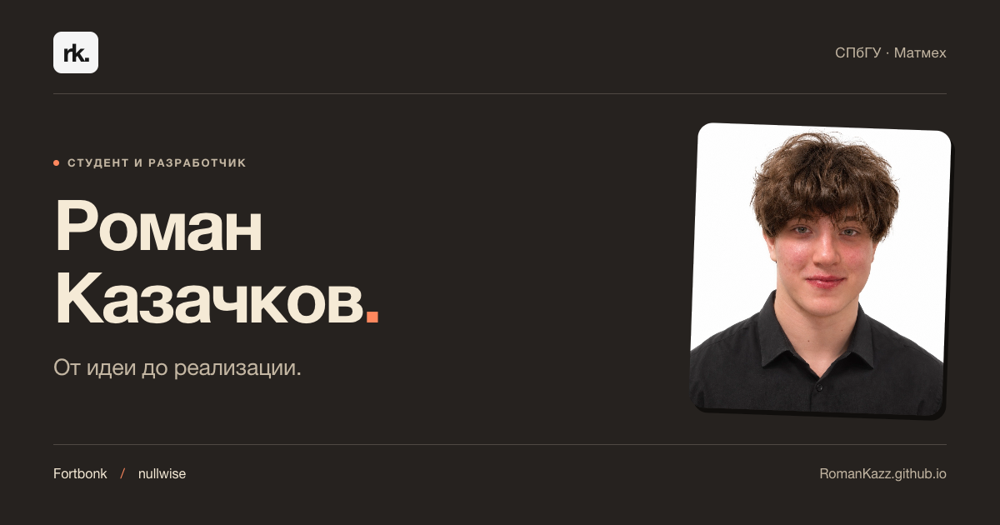

# Роман Казачков · личный сайт

Портфолио Казачкова Романа Андреевича, студента второго курса математико-механического факультета СПбГУ по направлению «Программная инженерия». Создано в рамках задания по веб-разработке.

**[Открыть сайт →](https://romankazz.github.io/web_portfolio/)**

[](https://romankazz.github.io/web_portfolio/)

## О проекте

Одностраничный сайт о моей учёбе, проектах и увлечениях:

- **Обо мне**: образование и интересы в программировании, искусственном интеллекте и дизайне интерфейсов.
- **Fortbonk**: игра от первого лица на C++ и raylib, сочетающая survivors-like, tower defense и строительство базы.
- **nullwise**: образовательный контент-проект о математике, примеры видео и результаты за первый месяц.
- **Вне кода**: пауэрлифтинг и результаты в трёх упражнениях.
- **Контакты**: Telegram, GitHub и почта с кнопкой копирования.

В оформлении используются тёплая палитра, оранжевые акценты, скругления и смещённые тени. Есть светлая и тёмная темы с сохранением выбора, адаптивная вёрстка, плавные переходы и появление элементов при прокрутке. При включённой системной настройке уменьшения движения анимации отключаются. Для ссылок на сайт настроены Open Graph и Twitter Card.

## Технологии

| Технология | Для чего используется |
| --- | --- |
| React 19 | Компоненты и интерактивность |
| Vite 7 | Сервер разработки и сборка |
| Tailwind CSS 4, CSS | Утилитарные классы, темы и оформление |
| shadcn/ui, Radix Slot, CVA | Компонент кнопки и его варианты |
| Lucide React | Иконки |
| GitHub Actions + Pages | Автоматическая сборка и публикация |

Сайт статический: серверная часть, база данных и переменные окружения для запуска не требуются.

## Запуск локально

Понадобятся Git, Node.js 22.12+ и npm.

```sh
git clone https://github.com/RomanKazz/web_portfolio.git
cd web_portfolio
npm ci
npm run dev
```

Откройте адрес, который Vite выведет в терминале. По умолчанию это `http://localhost:5173`.

| Команда | Результат |
| --- | --- |
| `npm run dev` | Локальный сервер с обновлением при изменении файлов |
| `npm run build` | Готовая сборка в каталоге `dist/` |
| `npm run preview` | Локальный просмотр готовой сборки |

Для проверки сборки выполните `npm run build`, затем `npm run preview`.

## Структура проекта

```text
src/
├── main.jsx                   # Страница, тема, биография и пауэрлифтинг
├── index.css                  # Основные стили и адаптивная сетка
├── motion.css                 # Переходы и микроанимации
├── components/
│   ├── fortbonk-details.jsx    # Раскрываемое описание игры
│   ├── nullwise-project.jsx    # Карточка математического канала
│   ├── contact-section.jsx     # Контакты и копирование почты
│   └── ui/button.jsx           # Общий компонент кнопки
├── hooks/use-page-motion.js   # Появление элементов при прокрутке
└── lib/utils.js               # Объединение CSS-классов
public/                       # Фотографии, обложки и og-image.png
design/open-graph.html        # Исходный макет изображения Open Graph
index.html                    # Точка входа и метаданные страницы
vite.config.js                # Настройки сборки и алиас @
.github/workflows/deploy.yml   # Публикация на GitHub Pages
```

Тексты редактируются в `src/main.jsx` и соответствующих компонентах. Цвета тем и кадрирование фотографий задаются в `src/index.css`. Чтобы заменить изображение, обновите файл в `public/` или путь к нему в компоненте.

## Публикация

Изменения автоматически публикуются после push в ветку `main`. Workflow устанавливает зависимости через `npm ci`, собирает сайт и отправляет содержимое `dist/` на GitHub Pages. Ход публикации можно посмотреть во вкладке [Actions](https://github.com/RomanKazz/web_portfolio/actions).

Для развёртывания в другом репозитории выберите **Settings → Pages → Source → GitHub Actions**. В Vite используется относительный `base: "./"`, поэтому ресурсы работают и в подкаталоге. При смене адреса сайта обновите canonical, `og:url` и ссылки на изображение предпросмотра в `index.html`.

Каталоги `node_modules/` и `dist/` не хранятся в Git: зависимости устанавливаются, а сборка создаётся при публикации.

## Контакты

[Telegram](https://t.me/loqieee) · [GitHub](https://github.com/RomanKazz) · [Email](mailto:roman.kazachkov1@gmail.com)
